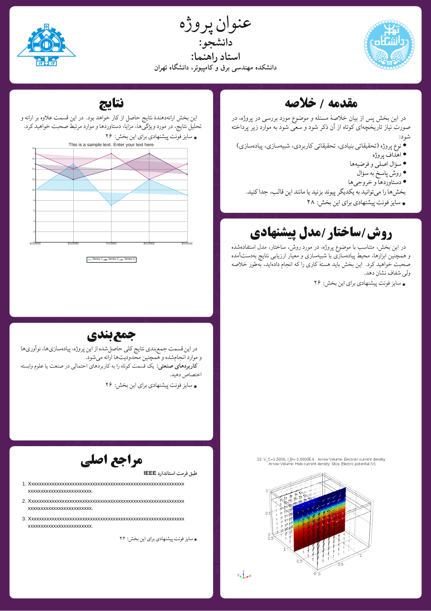

# tehran-poster

[](https://github.com/ParsaMOBB/ut-poster/actions/workflows/build.yml)
[](https://tug.org/xetex/)
[](https://ctan.org/pkg/xepersian)
[](#)
[](#)

A modular XeLaTeX template for Persian thesis posters at the University of Tehran.

<div dir="rtl">

قالب ماژولار لاتک برای پوستر پروژه و پایان‌نامهٔ دانشگاه تهران.

این پروژه بر اساس تمپلیت پوستر دانشگاه تهران و با کمک هوش مصنوعی ساخته شده
است.



## راهنمای فارسی

### ویژگی‌ها

1. صفحهٔ استاندارد A1 عمودی با ابعاد ۵۹٫۴ در ۸۴٫۱ سانتی‌متر.
2. حروف‌چینی کامل فارسی و راست‌به‌چپ با `XePersian`.
3. پشتیبانی از متن انگلیسی، فرمول‌های ریاضی و محتوای دوجهته.
4. طراحی ماژولار؛ اطلاعات سربرگ، محتوای بخش‌ها، چیدمان و ظاهر قالب از یکدیگر جدا هستند.
5. پنل‌های قابل جابه‌جایی و تغییر اندازه با دستور `PosterBlock`.
6. پشتیبانی از تصاویر واقعی و جای‌نگهدار خودکار برای تصاویر آماده‌نشده.
7. امکان رسم نمودارهای برداری و قابل ویرایش با `TikZ` و `PGFPlots`.
8. همراه با نشان‌های دانشگاه، پس‌زمینه، تصویر و نمودار نمونه.
9. قلم‌های فارسی و لاتین موردنیاز در خود پروژه قرار گرفته‌اند و به نصب جداگانه نیاز ندارند.
10. خروجی تک‌صفحه‌ای و مناسب چاپ با قلم‌های توکارشده در PDF.

### پیش‌نیازها

- یک توزیع کامل LaTeX مانند [TeX Live][texlive]، [MacTeX][mactex] یا MiKTeX
- موتور `XeLaTeX`
- ابزار `latexmk`
- بسته‌های `xepersian`، `tikz` و `pgfplots` که معمولاً در نصب کامل LaTeX موجود هستند

### دریافت و ساخت

</div>

```bash
git clone https://github.com/ParsaMOBB/ut-poster.git
cd ut-poster
chmod +x build.sh
./build.sh
```

<div dir="rtl">

فایل نهایی در مسیر زیر ساخته می‌شود:

</div>

```text
build/main.pdf
```

<div dir="rtl">

برای کامپایل مستقیم نیز می‌توان از دستور زیر استفاده کرد:

</div>

```bash
latexmk -xelatex main.tex
```

<div dir="rtl">

### ساختار پروژه

| مسیر | کاربرد |
|---|---|
| `config.tex` | عنوان، نام دانشجو، استاد راهنما، وابستگی سازمانی، تاریخ و لوگوها |
| `main.tex` | چیدمان، موقعیت و اندازهٔ پنل‌های پوستر |
| `tehran-poster.cls` | رنگ‌ها، قلم‌ها و دستورات قابل استفادهٔ مجدد |
| `sections/` | محتوای مستقل هر بخش پوستر |
| `assets/` | لوگوها، پس‌زمینه و تصاویر |
| `fonts/` | قلم‌های فارسی و لاتین همراه قالب |
| `build.sh` | ساخت خودکار خروجی PDF |

### تنظیم مشخصات پوستر

مشخصات اصلی در `config.tex` قرار دارند:

</div>

```tex
\PosterSetup{
  title={عنوان پروژه},
  student={نام و نام خانوادگی},
  supervisor={نام استاد راهنما},
  affiliation={دانشکده مهندسی برق و کامپیوتر، دانشگاه تهران},
  date={تابستان ۱۴۰۵}
}
```

<div dir="rtl">

### ویرایش بخش‌ها

متن هر پنل در فایل جداگانه‌ای داخل `sections/` قرار دارد. برای نمونه، محتوای
مقدمه در `sections/introduction.tex` و نتایج در `sections/results.tex` نوشته
می‌شود.

جایگاه و اندازهٔ پنل‌ها در `main.tex` با ساختار زیر مشخص می‌شود:

</div>

```tex
\PosterBlock[اندازهٔ متن]
  {عنوان بخش}
  {فاصله از چپ}
  {فاصله از بالا}
  {عرض}
  {ارتفاع}
  {محتوا}
```

<div dir="rtl">

تمام فاصله‌ها می‌توانند با واحدهایی مانند `cm` نوشته شوند.
آرگومان اختیاری اول، اندازهٔ واقعی متن پنل بر حسب پوینت است؛ برای نمونه
`\PosterBlock[28]{...}` متن آن پنل را با اندازهٔ ۲۸ پوینت حروف‌چینی می‌کند.

### فارسی، انگلیسی و فرمول

متن عادی به‌صورت پیش‌فرض فارسی و راست‌به‌چپ است. برای عبارت کوتاه انگلیسی از
`\PosterEnglish` استفاده کنید:

</div>

```tex
مدل پیشنهادی بر اساس \PosterEnglish{Transformer} طراحی شده است.
```

<div dir="rtl">

برای یک پاراگراف، جدول یا نمودار کامل انگلیسی، محیط `latin` مناسب است:

</div>

```tex
\begin{latin}
This paragraph is typeset from left to right.
\end{latin}
```

<div dir="rtl">

فرمول‌ها به شیوهٔ معمول LaTeX نوشته می‌شوند و می‌توانند داخل متن فارسی قرار
بگیرند:

</div>

```tex
تابع هزینه به‌صورت زیر تعریف می‌شود:
\[
  \mathcal{L}(\theta)
  = \frac{1}{N}\sum_{i=1}^{N}(y_i-\hat{y}_i)^2.
\]
```

<div dir="rtl">

### تصاویر و جای‌نگهدارها

</div>

```tex
\PosterImage[20cm]{assets/my-result.png}{15cm}
```

<div dir="rtl">

آرگومان اختیاری، عرض تصویر و آرگومان آخر بیشینهٔ ارتفاع آن است. اگر فایل تصویر
وجود نداشته باشد، یک جای‌نگهدار چاپی نمایش داده می‌شود و چیدمان پوستر حفظ خواهد
شد.

### تغییر رنگ قالب

رنگ‌های اصلی را می‌توان در `config.tex` بازتعریف کرد:

</div>

```tex
\definecolor{PosterPurple}{HTML}{57215D}
\definecolor{PosterBlue}{HTML}{55C6EC}
```

## English Guide

`tehran-poster` is a portable A1 portrait poster template built with XeLaTeX.
It provides native Persian RTL typesetting, mixed Persian/English content,
mathematics, editable vector charts, configurable metadata, movable panels,
bundled fonts, and automatic image placeholders.

Project-specific metadata is defined in `config.tex`, section content lives in
`sections/`, and panel geometry is controlled from `main.tex`.

Build the poster with:

```bash
./build.sh
```

The generated PDF is written to `build/main.pdf`.

[texlive]: https://tug.org/texlive/
[mactex]: https://tug.org/mactex/
[xepersian]: https://ctan.org/pkg/xepersian
